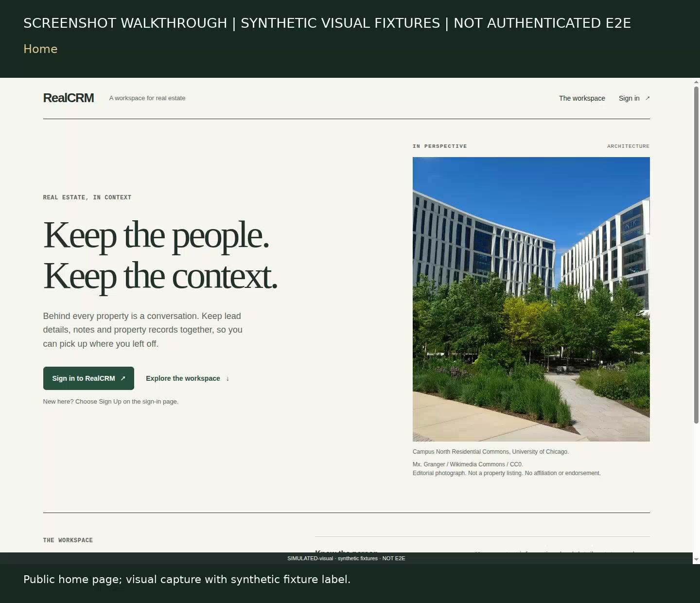

# RealCRM — Real Estate Agent Helper

RealCRM is a React-based real-estate CRM prototype for organizing leads, properties, and message views. The repository preserves a React, TypeScript and Vite frontend; an Express and Drizzle backend; and PostgreSQL with Neon HTTP as the default database transport. Existing Google OAuth, Gmail, Gmail Watch and Pub/Sub architecture is preserved.

> **Not production ready.** The reviewed visuals, frontend build and bounded local runtime/bootstrap checks are interim evidence only. Authentication/OAuth and cache safety, core CRUD and message contracts, and an end-to-end Google-shaped email-push simulation remain unfinished. No live provider integration has been tested. Do not use real customer data or credentials.

## Walkthrough

[](docs/demo/walkthrough.mp4)

[Play the silent screenshot walkthrough](docs/demo/walkthrough.mp4) · [Walkthrough method and limitations](docs/demo/README.md)

This is a labeled montage of independently reviewed browser screenshots with synthetic visual fixtures—not a live recording, authenticated session, or proof that actions persist.

## Current scope and limitations

The existing interface includes a public home/login/onboarding flow and CRM views for dashboard, leads, properties, messages, and settings. The source also contains Google/Gmail and other provider-related code, but source presence is not evidence of a working integration. Existing Telnyx, Twilio, OpenAI and Microsoft Graph/Outlook code is **not** claimed as a working or tested integration. Google/Gmail live OAuth, Watch, Pub/Sub, and delivery have not been tested.

The [feature matrix](docs/FEATURE-MATRIX.md) is a historical baseline inventory, not current acceptance. [Verification evidence](docs/VERIFICATION.md) is chronological and distinguishes bounded passes from known failures, simulations, and blocked workflows. Final application acceptance is unfinished. Auth/OAuth and cache safety, core CRUD contracts, message sending/persistence, and authenticated end-to-end email-push simulation still need work and independent review.

## Local setup and safe checks

See [Local setup](docs/LOCAL-SETUP.md) first. It documents special Linux host-root, `/proc` socket access, and a **specific already-retained task-owned PostgreSQL container** required by the isolated runtime checks. It is not a generic promise that a fresh local database works with the default Neon HTTP transport. Do not point these checks at a real database or provider account.

Use Node **22.22.0 on PATH before installing dependencies**. The verification commands below use its cached npm package explicitly (`--offline` fails if it is not cached). Dependencies were already installed in the reviewed workspace; these are setup recipes, **not a claim that `npm ci` was freshly run for this interim documentation candidate**:

```sh
(cd frontend && npm ci --ignore-scripts)
(cd backend && npm ci --ignore-scripts)
```

Fresh sequential checks on this isolated documentation/media candidate passed: **61 frontend tests**, lint, forced TypeScript checking, and the full `tsc -b && vite build`. The generated HTML/JS/CSS also passed a local HTTP/byte-equality smoke check. This is component/static-build evidence, not authenticated browser acceptance. Commands from `frontend/`:

```sh
# frontend — tests, lint, forced TypeScript check, full build
cd frontend
npm exec --offline --package=node@22.22.0 -- npm test
npm exec --offline --package=node@22.22.0 -- npm run lint
npm exec --offline --package=node@22.22.0 -- npm exec -- tsc -b --force
npm exec --offline --package=node@22.22.0 -- npm run build

# optional loopback preview of the built frontend
npm exec --offline --package=node@22.22.0 -- npm run preview -- --host 127.0.0.1 --port 4175 --strictPort
```

The backend checks are deliberately narrower. Keep inherited URLs/provider settings out of test/build shells (the recorded run used a clean environment; see the interim record). The startup-boundary command runs from `backend/`; the pure-scoring command runs from repository root. Optional frontend preview serves the ordinary app, **not the screenshot fixture harness**: do not sign in, connect providers, or treat it as safe authenticated acceptance.

```sh
env -i PATH="$PATH" HOME=/root npm exec --offline --package=node@22.22.0 -- node --test --test-name-pattern='startup boundaries|default server' test/local-runtime.test.js
```

```sh
# repository root
env -i PATH="$PATH" HOME=/root npm exec --offline --package=node@22.22.0 -- node --test backend/test/lead-scoring.test.js
```

Fresh targeted runs passed **2 startup/default-server tests** and **53 pure-scoring tests**. These do not establish repaired auth, database workflows, or provider integration. The separately documented real local runtime command requires the retained Linux/container prerequisites in [Local setup](docs/LOCAL-SETUP.md); it creates a synthetic database and was deliberately not rerun for this docs-only task. **Do not run backend `npm test`, blanket test discovery, Gmail/phone/Outlook tests, or database tests outside their documented isolated commands.** No full backend-suite pass is claimed. See the [interim verification record](docs/INTERIM-PR.md) for exact environment, results, and limits.

## Architecture

- **Frontend:** React, TypeScript, Vite, React Router.
- **Backend:** Node.js and Express; Drizzle ORM.
- **Data:** PostgreSQL schema, with Neon HTTP/Drizzle as the default application transport.
- **Preserved Google path:** Google OAuth and Gmail clients, Gmail Watch renewal, and Pub/Sub webhook processing. The intended path is a Google notification to Pub/Sub, backend processing of Gmail history/messages, then application persistence; this architecture has not been validated end-to-end here.

Provider-related source is not a guarantee of operational or production readiness. No live Gmail, Google Cloud, Telnyx, Twilio, OpenAI, or Graph operation was performed for this documentation/media work.

## Project records

- [Local setup and retained-container prerequisites](docs/LOCAL-SETUP.md)
- [Historical feature/route matrix](docs/FEATURE-MATRIX.md)
- [Chronological verification evidence](docs/VERIFICATION.md)
- [Visual verification](docs/VISUAL-VERIFICATION.md)
- [Image provenance and credits](docs/IMAGE-CREDITS.md)
- [Demo source manifest and reproducibility notes](docs/demo/README.md)

The walkthrough reproduces actual reviewed screenshots. The home-page photograph's source and license are documented in [Image credits](docs/IMAGE-CREDITS.md); the montage itself uses no additional imagery.
